<!-- Cyberpunk Dragon Header (custom animated SVGs in /assets) -->

  

<!-- Dragon Card: wing (Portfolio) + head + wing (CV) + views -->

  <a href="https://samerabuzaina.netlify.app/">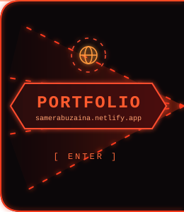</a><a href="https://samerabuzaina.netlify.app/SamerCv.pdf">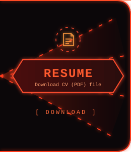</a>

  

 

<!-- ===================== ABOUT ME ===================== -->

  

  

  

 

<!-- ===================== TECH ARSENAL ===================== -->

  

  

 

<!-- ===================== FEATURED PROJECTS ===================== -->

  

<!-- ---------- MOBILE APPS ---------- -->

  

<!-- 1) Wathiq -->
<h3 align="center">🔥 Wathiq</h3>

  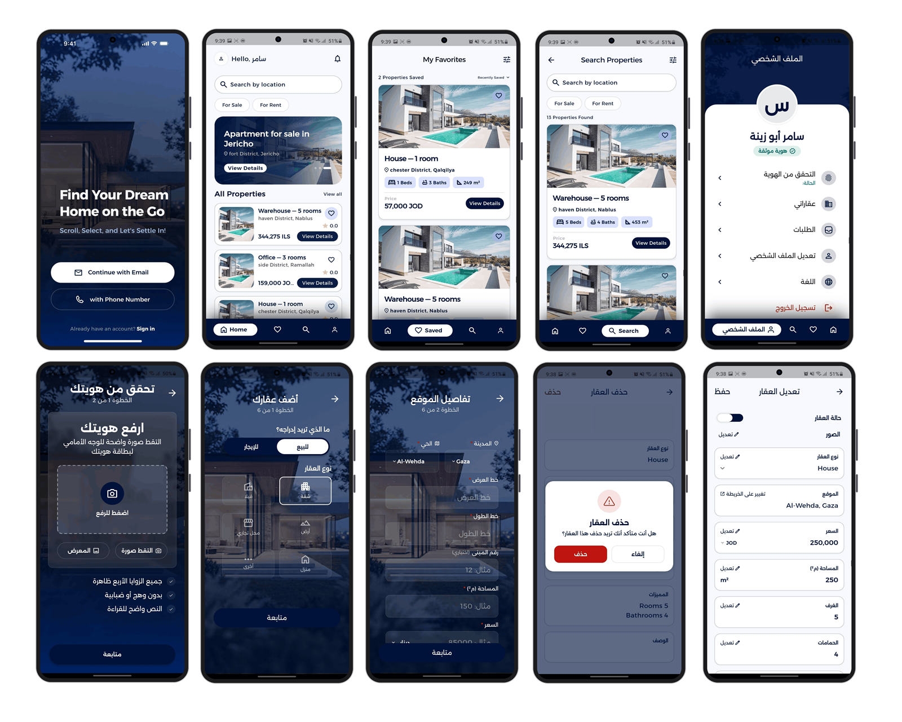

  <a href="https://drive.google.com/drive/u/0/folders/1sHJvdEKfIHxTb6NO-s3kHtdo86ZknH31">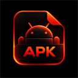</a>
  &nbsp;&nbsp;&nbsp;&nbsp;
  

 

<!-- 2) Kick Off -->
<h3 align="center">🔥 Kick Off</h3>

  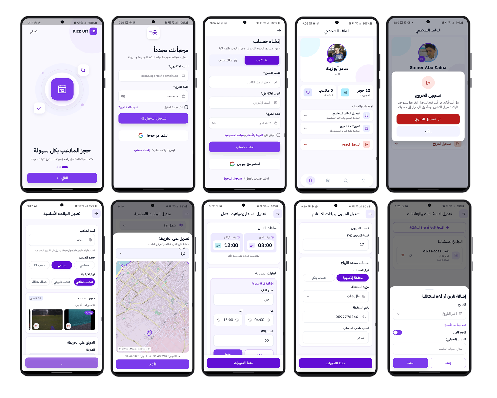

  
  &nbsp;&nbsp;&nbsp;&nbsp;
  

 

<!-- 3) Rento -->
<h3 align="center">🔥 Rento</h3>

  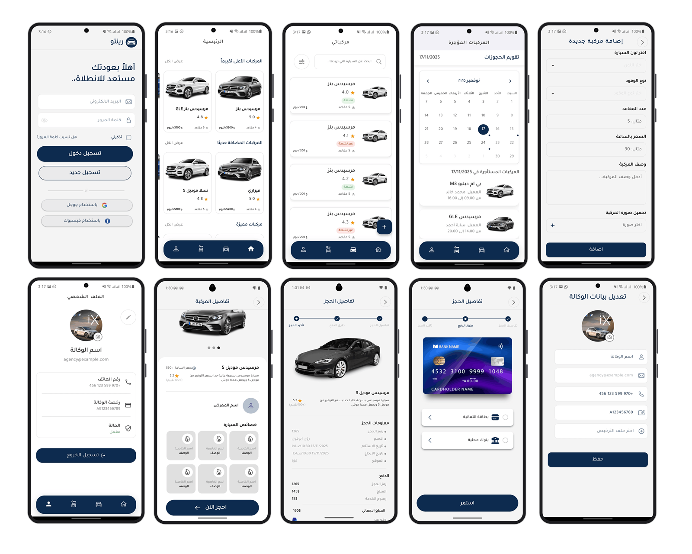

  
  &nbsp;&nbsp;&nbsp;&nbsp;
  

 

<!-- 4) B Store -->
<h3 align="center">🔥 B Store</h3>

  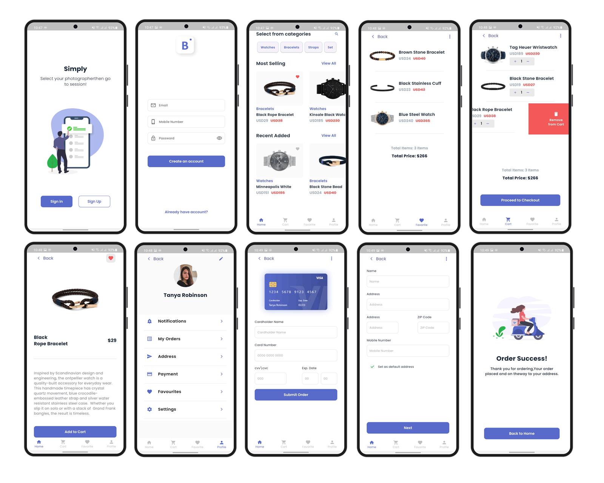

  
  &nbsp;&nbsp;&nbsp;&nbsp;
  

 

<!-- 5) Momma Fashion -->
<h3 align="center">🔥 Momma Fashion</h3>

  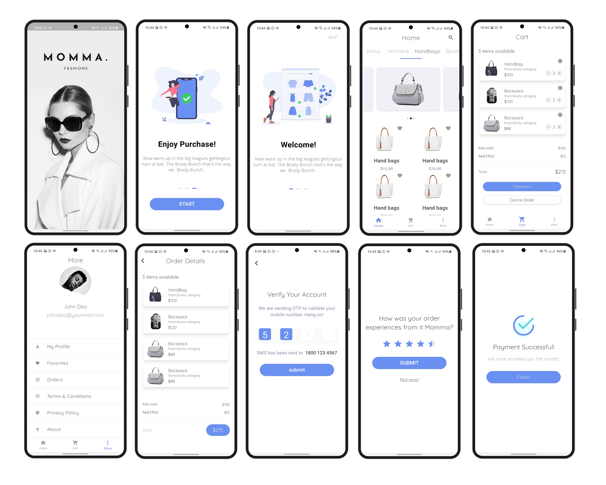

  
  &nbsp;&nbsp;&nbsp;&nbsp;
  

 

<!-- ---------- OTHER PROJECTS ---------- -->

  

<!-- 1) Facial Emotion Recognition -->
<h3 align="center">🔥 Facial Emotion Recognition using Deep Learning</h3>

  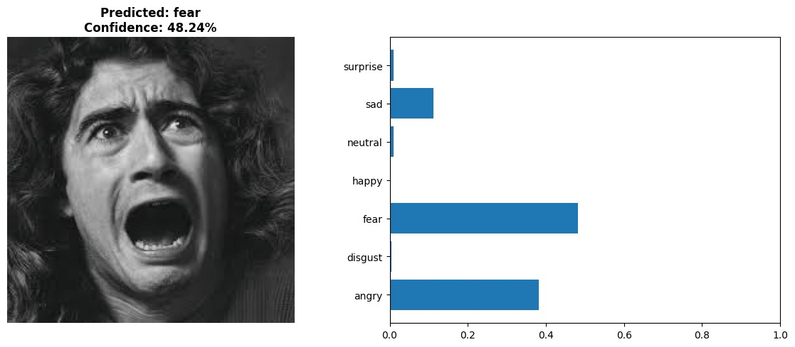

  
  &nbsp;&nbsp;&nbsp;&nbsp;
  

 

<!-- 2) Smart Fire Detection -->
<h3 align="center">🔥 Smart Fire Detection and Alert System</h3>

  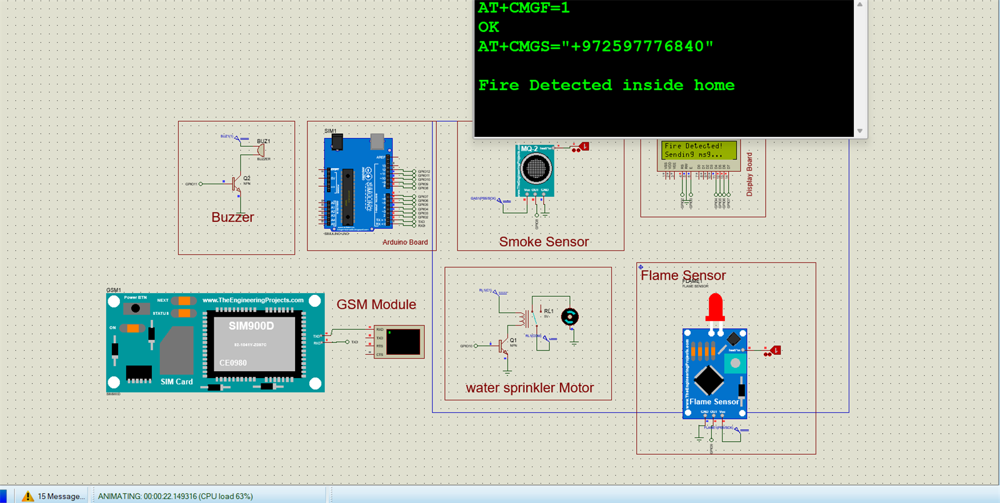

  

 

<!-- ===================== GITHUB STATS ===================== -->

  

<!-- Streak card: generated daily by workflow, dragon theme -->

  

<!-- Dragon eating the contribution grid (generated daily by the workflow, served from the "output" branch) -->

  

 

<!-- ===================== LET'S CONNECT ===================== -->

  

  
  
  
  
  <a href="https://leetcode.com/u/SAZ4j/"></a>

 

<!-- ===================== FOOTER ===================== -->

  

